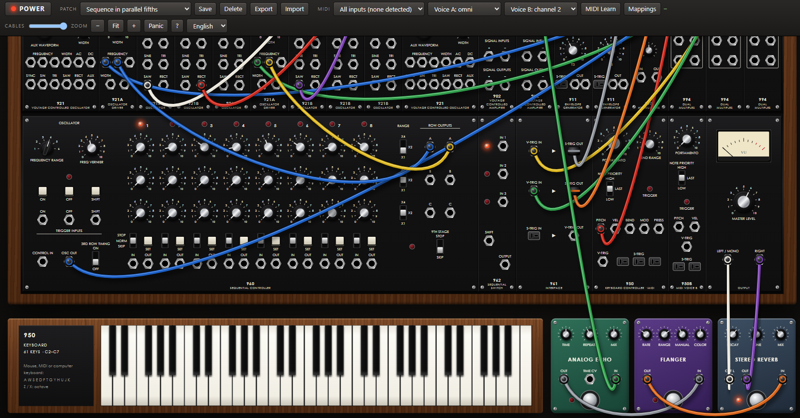

# Goong55 — web emulation of a Moog System 55-style modular synthesizer



A static web app with no dependencies and no build step (AudioWorklet + Web MIDI).

```bash
python3 serve.py
```

Then open <http://localhost:8055/> in Chrome, Edge or Firefox. Audio and MIDI require `localhost` or HTTPS, so opening `index.html` as a file does not work. `serve.py` is a plain static server that disables browser caching; pass a port number to use a different one.

```bash
node test/render.mjs
```

Offline engine tests: tuning, 1 V/oct filter tracking, envelope timing, the sequencer, and every factory patch (each must produce sound without clipping).

## Using it

- **Power**: the synth is on by default. If the browser blocks audio on load, it starts on the first click or key press.
- **Knobs**: drag up/down or use the wheel; Shift for fine adjustment; double-click resets.
- **Cables**: drag from jack to jack. To remove one, pull an end and drop it on nothing. One cable per jack; use the 994 multiples to split a signal.
- **Triggers**: rectangular jacks are S-triggers (keyboard to envelopes). The 960 outputs V-triggers, which the 961 converts.
- **Keyboard**: on-screen keys, computer keys (`A W S E D F T G Y H U J K`, `Z`/`X` for octave) or MIDI.
- **MIDI**: voice A (950 panel) receives notes, pitch bend, mod wheel and aftertouch; voice B (950B panel) receives the notes on its own channel (channel 2 by default). Right-click any knob, switch or button and choose *MIDI learn* to map a hardware control (CC, pitch bend or channel pressure). Mappings are stored in the browser.
- **Patches**: 33 factory patches grouped by category, plus save, export and import as JSON.
- **Language**: Spanish or English, from the selector in the toolbar. Panel legends stay in English.

## Structure

| File | Contents |
| --- | --- |
| `dsp/engine.js` | The engine: one model per module and the patch graph, run sample by sample at 2× the output rate |
| `dsp/worklet.js` | AudioWorklet wrapper |
| `js/defs.js` | Panels (controls, jacks, positions), cabinet layout, and cable/multiple resolution |
| `js/ui.js` | Drawing of the cabinet, controls, cables, pedals and keyboard |
| `js/midi.js` | Web MIDI and control mapping (MIDI learn) |
| `js/presets.js` | Factory patches |
| `js/i18n.js` | Interface strings in Spanish and English |
| `js/main.js` | Application state, audio start-up, toolbar |
| `test/render.mjs` | Offline engine tests |

## Models

Signals are in volts: 1 V/oct (0 V = C2 on 8'), audio around ±1 V, envelopes peak at 5.5 V, V-triggers are 0/5 V, S-triggers are a switch closure.

The models reproduce the behaviour of each circuit; they are not component-level simulations of the schematics. Some values come from memory or secondary sources and have not been checked against Moog documentation: the 914 low-pass and high-pass corners (88 Hz and 7 kHz), the exact range of some knobs, and the 5.5 V envelope peak.

- **921 / 921A / 921B** — sawtooth core (integrator + comparator) with polyBLEP; triangle by rectification, sine from a shaper with residue, rectangular from a comparator; weak/strong sync, linear AC/DC FM, slow thermal drift and a per-oscillator calibration error. The 921Bs hang off their 921A through internal wiring.
- **904A** — four-stage transistor ladder with `tanh` per stage and feedback (Huovilainen's model, 4× effective oversampling), no bass compensation; it self-oscillates and tracks 1 V/oct.
- **904B** — 24 dB/oct high-pass. **914** — low-pass, 12 half-octave resonators and high-pass.
- **902** — differential pair, differential inputs, linear or exponential (12 dB/V) response, maximum gain ×2.
- **911** — RC contour: T1 towards a level above the peak, T2 towards Esus, T3 to zero; 2 ms–10 s. **911A** — dual trigger delay.
- **CP3A** — discrete summing stage with soft asymmetric clipping when driven.
- **960 / 961 / 962** — 3×8 sequencer with skip/normal/stop modes, ninth stage and third-row timing control; V↔S-trigger interface; sequential switch.
- **950** — monophonic, single trigger, selectable note priority, RC portamento; extra outputs for MIDI velocity, bend, mod wheel and aftertouch.

## Departures from a real System 55

- Not included: 904C, 992/993, the 956 ribbon controller, and the 921 clamp input.
- There is a second 921, which the original does not have, for use as an LFO.
- The 950 panel adds velocity, bend, mod wheel and aftertouch outputs.
- **950B** is an extra, compact second MIDI voice (pitch, velocity and triggers) so two timbres can be played from two MIDI channels.
- Three **effect pedals** sit next to the keyboard and are patched like modules: an analog-style echo (20 ms–1 s, dark saturating repeats, time CV input), a flanger, and a stereo reverb.
- No Moog logo is used.
